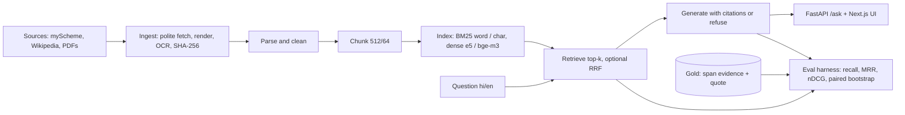

# IndicRAG

**Ask a question about an Indian government scheme in Hindi or English, get an answer that cites the exact passage it came from, and know with numbers how often that works.**

   

**In one minute:** people look up pensions, ration cards, scholarships and tax rules in Hindi and English, and the answers are scattered across government pages, PDFs and Wikipedia. A chatbot can answer, but it can also invent a number or an eligibility rule. IndicRAG is a small, measured system for this: it retrieves passages from the source documents, answers only from them with citations, refuses when the documents do not say, and ships with a labelled question set and an evaluation harness so every claim about quality comes with a number and its limits.

> **Status: alpha. Working system, early measurements.** 100 pilot questions (57 English, 43 Hindi), written by an LLM from sampled passages and reviewed by one author-reviewer; the last 25 were checked by a model reviewer whose decisions the author adopted. At this size most differences between retrieval methods are within noise. Read [Results](#results) and [Honest limits](#honest-limits) before quoting any number.

---

## The situation

A citizen asks: *"What is the monthly pension under the Atal Pension Yojana if I join at 25?"* or, in Hindi, *"आरटीआई के तहत प्रति पृष्ठ कितनी फीस लगती है?"*. The honest answer depends on a specific page. If a language model answers from memory it may be wrong, and nobody can check it. If a retrieval system answers from the page and shows the passage, the person (or a reviewer) can verify it.

## The idea

1. **Retrieve** the passages most likely to hold the answer (keyword search, embeddings, or both).
2. **Answer only from those passages**, with a citation after each claim. A citation that does not point at a retrieved passage is rejected.
3. **Refuse** (`NO_ANSWER`) when the passages do not contain the answer.
4. **Measure** all of it against gold questions whose evidence is a character span in a hashed source document, so retrieval can be scored without depending on how the text was chunked.



### Words used in this README

| Word | Meaning |
|---|---|
| **RAG** | Retrieval-augmented generation: look up passages first, then answer from them. |
| **Gold set** | Questions with answers and the exact source passage, used as the answer key. |
| **Span evidence** | The answer's evidence stored as character offsets plus a verbatim quote in a hashed document, not as a chunk id. |
| **recall@k** | Share of questions where the gold passage is in the top k retrieved chunks. |
| **MRR** | Mean reciprocal rank: how high the first correct chunk is ranked, on average. |
| **BM25** | Classic keyword ranking. *Char n-gram* BM25 matches on 3-5 character pieces, which helps with Hindi word forms. |
| **Dense retrieval** | Ranking by embedding similarity (e5-small, bge-m3). |
| **Hybrid (RRF)** | Combining the keyword and dense rankings with reciprocal rank fusion. |
| **Oracle** | A test where the model is given the whole gold document, so retrieval cannot fail. An upper bound, not a deployable mode. |
| **Closed-book** | The same model with no passages: shows how much it already knows. |
| **Number recall** | Share of the gold answer's numbers that appear in the model's answer. Objective, but a weak proxy for correctness. |

## What is in the repo

| Component | Where | State |
|---|---|---|
| Polite ingestion (HTML, PDF, headless render, OCR), content-addressed storage, licence-aware manifest | `src/ingest`, `src/parse` | working, tested |
| Chunking (fixed / heading), OCR-noise gate, span-hit rule | `src/chunk` | working, tested |
| Retrieval: BM25 (word, char n-gram), dense (multilingual-e5-small, bge-m3), hybrid RRF | `src/retrieve`, `src/embed` | working, tested |
| Eval harness: gold validator, recall / MRR / nDCG, paired bootstrap, generation scoring | `src/evalrunner` | working, tested |
| Cited-answer generation with citation validation and refusal; PII scrubbing | `src/generate`, `src/security` | working, tested |
| FastAPI service (`/ask`, `/feedback`, `/docs/{id}`, health) with rate limit, budget cap, kill switch; Next.js UI | `src/api`, `web/` | working, browser smoke test |
| Eligibility agent: deterministic rules engine, validated read-only tools, budgeted loop with JSON traces | `src/agent` | working; no advantage over RAG measured |
| pgvector schema, Docker Compose, CI | `db/`, `docker-compose.yml`, `.github/` | working |

On a clean clone 96 tests pass and 5 skip (they need the locally built corpus); `ruff` is clean.

## Try it

```
python3 -m venv .venv && .venv/bin/pip install -r requirements-api.txt -r requirements-spike.txt
make test                        # no network, no API key, no model download
make ingest-myscheme             # fetch the English corpus locally (not redistributed)
make chunk && make api           # retrieval-only unless ANTHROPIC_API_KEY is set
cd web && npm ci && npm run dev  # UI on :3000, proxies /api to :8000
```

Dense retrieval needs `requirements-embed.txt`. `make results GOLD=data/gold/dev.jsonl` reproduces the retrieval tables from the published gold set once you have built the corpus and embeddings. Docker: `CLIENT_SALT=$(openssl rand -hex 8) docker compose up --build`. The corpus is fetched under each source's terms and is never committed or baked into images. Step-by-step operation and troubleshooting: [`docs/runbook.md`](docs/runbook.md).

## Results

Full tables and caveats: [`eval/RESULTS.md`](eval/RESULTS.md). Headline, on 96 answerable items:

- **Retrieval:** all six configurations put the gold passage in the top 5 for 95-97% of items; recall@1 ranges from 0.63 to 0.78. e5-small dense is the consistent laggard (char-BM25 and both hybrids beat it with intervals excluding zero); the others are mostly not separated. Questions share vocabulary with their passages, which favours lexical matching, so this is not evidence that BM25 beats dense retrieval in general.
- **Generation (claude-haiku-5-5):** number recall 0.92 with retrieval vs 0.63 closed-book (paired difference +0.29, 95% CI +0.18 to +0.41). With the whole gold document in context: 0.93, so retrieval is not the bottleneck on these items. Abstention on four unanswerable questions: 4/4 (a tiny sample).
- **Hindi caveat:** closed-book Hindi recall is 0.84 because many items concern well-known national schemes, so the Hindi slice tests retrieval less than the English one.
- **Agent:** on 30 easy single-document eligibility tasks, plain RAG 29/30 vs agent 26/30 (all agent misses were the token budget). No advantage shown.
- **Injection:** 0-2 of 24 cases flagged by an upper-bound check; flagged answers read as reporting, not obeying, the injection.

## Design choices that matter

- **Gold evidence is a span, not a chunk id** (document hash, parsed-text hash, parser version, character offsets, verbatim quote). A retrieved chunk hits if it contains the span or overlaps it by at least half, so chunking strategies are compared fairly. The validator checks `quote == text[start:end]`. See [ADR 0002](docs/adr/0002-span-level-gold-evidence.md).
- **Distractors:** the index holds the whole local corpus (about 400 documents), so every query competes against all documents.
- **Baselines next to RAG:** closed-book, and an oracle with the whole gold document in context. A true whole-corpus long-context run is not done (the corpus is about 1M tokens).
- **No same-family judge.** Generation is scored by number recall, which is objective but weak; faithfulness and fluency are not scored yet. See [ADR 0003](docs/adr/0003-number-recall-instead-of-llm-judge.md).
- **Paired statistics** (paired bootstrap) with the number of comparisons stated.
- **Documents are untrusted input:** 24 prompt-injection cases, PII scrubbing before logging, no personal data stored.
- **Kannada is out of v1** because nobody on the project can validate it. See [ADR 0004](docs/adr/0004-kannada-out-of-v1.md).

## Is this for you?

**Good fit:** you want a worked, measured example of RAG over multilingual public-service documents; a labelled Hindi/English question set with span-level evidence; or a harness for comparing retrievers with paired statistics.

| Situation | Better choice |
|---|---|
| You need a production citizen helpline | This is a reference implementation: no authentication, multi-tenancy or SLA. Build on it, do not deploy it as is. |
| You need legal or eligibility advice people will rely on | Not supported. Answers quote sources, which may be out of date; talk to the scheme office. |
| You need a large benchmark with agreement statistics | 100 items and one reviewer is a pilot. Wait for the larger set or add reviewers. |
| You need Kannada or other Indian languages | Not covered. The Kannada tooling is groundwork only. |
| Your documents are one language and already well structured | A keyword index may be all you need; see the retrieval results above. |

## Honest limits

- **Small and single-reviewer.** 100 questions; one author-reviewer, no agreement statistic; 25 items were checked by a model reviewer whose decisions the author adopted.
- **Questions favour keyword search.** They were drafted from passages and share vocabulary with them.
- **Different kinds of test per language.** The Hindi corpus is mostly Wikipedia and English is mostly myScheme pages, so they are not a clean cross-language comparison.
- **Weak generation scoring.** Number recall cannot see a wrong answer that happens to contain the right numbers. No faithfulness or fluency score.
- **Same-family generation.** The generator and nearby tooling are Claude models; no cross-family judge.
- **Not a production service**, and not legal, financial or official eligibility advice. Rules change; some gold answers reflect an older version of a scheme.
- **Alpha status.** The agent's task criteria have never had human review; the whole-corpus long-context baseline was not run.

## Data and licensing

- **Code: MIT** (see [`LICENSE`](LICENSE)). The licence covers the code only.
- The gold set (`data/gold/dev.jsonl`, 100 questions with short evidence quotes, no full documents) is published; see [`data/gold/NOTICE.md`](data/gold/NOTICE.md) for sources and terms. Wikipedia-derived quotes are CC BY-SA 4.0. myScheme excerpts were included without asking the portal owners, and a per-source licence review was not completed ([`docs/03-corpus-and-licensing.md`](docs/03-corpus-and-licensing.md)). The full raw corpus stays local and gitignored: rebuild it with `make ingest-myscheme`.
- Dataset card draft: [`docs/17-dataset-card-draft.md`](docs/17-dataset-card-draft.md). Labelling guide: [`docs/04-labelling-guide.md`](docs/04-labelling-guide.md).
- No model training, no voice, no collection of personal data.

## Documentation

| Read | For |
|---|---|
| [`eval/RESULTS.md`](eval/RESULTS.md) | Every number, its sample size and its limits |
| [`docs/architecture.md`](docs/architecture.md) | How the pieces fit together today |
| [`docs/critique.md`](docs/critique.md) | An adversarial self-review: what is weak and what to fix first |
| [`docs/runbook.md`](docs/runbook.md) | Running, rebuilding and troubleshooting |
| [`docs/adr/`](docs/adr/) | Architecture decision records |
| [`SCORECARD.md`](SCORECARD.md) | Production-readiness checklist with evidence and gaps |
| [`docs/11-security-and-ops.md`](docs/11-security-and-ops.md) | Threat model, PII, abuse and cost controls |
| `docs/01`-`docs/17` | Original plans: scope, evaluation, chunking, retrieval, app, agent, labelling guide |
| [`CHANGELOG.md`](CHANGELOG.md), [`CONTRIBUTING.md`](CONTRIBUTING.md) | History and how to contribute |

## Scope decision: Kannada is out of v1

Kannada was an original goal. It is deferred because the project has no native Kannada reader to validate questions or answers. The fetched Kannada documents and the English-Kannada alignment tooling (`scripts/align_kn_candidates.py`, `src/evalrunner/align.py`) remain as groundwork. No result here covers Kannada.

## Contributing and author

See [`CONTRIBUTING.md`](CONTRIBUTING.md). Licensed under the [MIT License](LICENSE). Arpit Pandey: data engineering, evaluation, backend, frontend and agents. Contributions welcome: label corrections, sources with clear licences, and Hindi reviewers. Open an issue.
