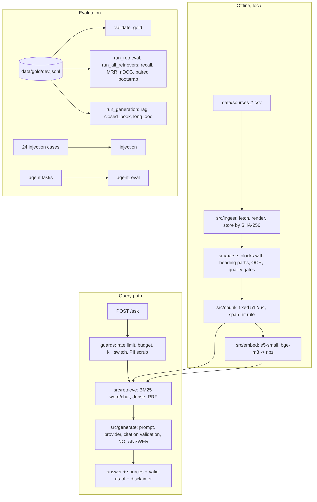

# Architecture (as built)

The original plan is `docs/02-architecture.md`. This page describes what exists today.

## Components

| Package | Job | Key invariant |
|---|---|---|
| `src/ingest` | Polite fetch (robots, rate limit), headless render, content-addressed raw store, manifest | `redistribute` defaults to `false`; `Config.min_content_chars=450` rejects empty shells |
| `src/parse` | HTML/PDF to text with heading paths; OCR; boilerplate removal | Every parse records a `parser_version` and `parsed_sha256` |
| `src/chunk` | Fixed or heading chunks; OCR-noise gate | Chunks keep `doc_id, section_path, char_span, lang` |
| `src/embed` | Embedding models behind one interface | E5 `query:`/`passage:` prefixes are enforced |
| `src/retrieve` | BM25 (word, char 3-5-gram), dense, RRF (k=60) | Same interface for every system so comparisons are paired |
| `src/generate` | Versioned prompt, provider interface, citation validation, refusal | A citation to a chunk that was not retrieved is rejected |
| `src/api` | FastAPI: `/ask /feedback /docs/{id} /healthz /readyz` | Retrieval-only when no API key; budget cap and kill switch |
| `src/security` | PII scrubbing before logging | Documents are untrusted input |
| `src/agent` | Rules engine, schema-validated read-only tools, budgeted loop, JSON trace | Decision must match the rules engine; cited ids must have been seen |
| `src/evalrunner` | Gold validator, metrics, runners, injection and agent evals | Gold evidence is a span ([ADR 0002](adr/0002-span-level-gold-evidence.md)) |
| `web/` | Next.js UI proxying `/api` | Shows sources, valid-as-of date and disclaimer |
| `db/migrations` | pgvector schema | One database for vectors and metadata |

## Data flow and storage
- `data/raw/<source_id>/<sha256>.<ext>` and `data/processed/<source_id>/`: local, gitignored.
- `data/chunks/*.jsonl`, `data/embeddings/*.npz`: derived, gitignored, rebuild with `make chunk` and `python -m src.embed build`.
- `data/gold/dev.jsonl`: published gold set (see `data/gold/NOTICE.md`).
- `eval/RESULTS.md`: hand-maintained results with limits, reproduced by `make results`.

## Decisions
See [`docs/adr/`](adr/). Security, privacy and cost controls: [`docs/11-security-and-ops.md`](11-security-and-ops.md).
